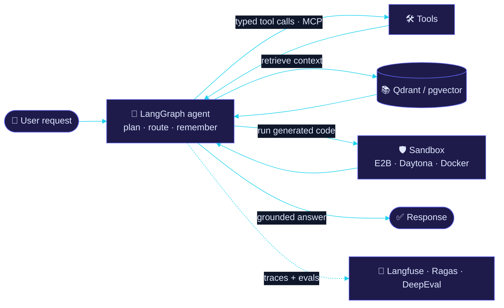

<!--
  SPACE-TECH THEME · PLAIN-LANGUAGE EDITION
  The space look lives in the visuals (banner, dividers, orbit map, footer).
  All headings and text are written plainly so visitors can scan the page quickly.

  Palette: void #03040C · deep navy #0F172A · indigo #6366F1 · cyan #22D3EE · violet #A78BFA
  Animated visuals live in ./assets (header.svg, divider.svg, footer.svg, orbit.svg, stack.svg).
  GitHub plays their CSS/SMIL animations when they are embedded with , so keep them as  tags.

  Live pieces (all auto-updating, same palette):
    - Typing tagline ........ readme-typing-svg
    - Streak / stats / langs  streak-stats.demolab.com · github-readme-stats · github-profile-summary-cards
    - Contribution snake .... .github/workflows/snake.yml  (writes to the "output" branch)
    - Latest pushes table ... .github/workflows/recent-pushes.yml  (rewrites the PUSHES block below)

  GitHub strips JavaScript. Interactivity here = collapsible sections, jump links, animated SVGs, Mermaid.
  Tip: leave a blank line after every 
 so Markdown inside a collapsible section renders.
-->

 

 

## 👨‍🚀 About Me

I have **~3 years of hands-on experience** across the AI stack. I started by building AI features; today I design and ship **production-ready AI products** — from agent architecture and retrieval pipelines to sandboxed execution, deployment, and observability.

What I care about is the part that makes AI products trustworthy, not just impressive in a demo:

> **`RELIABILITY`** · **`LATENCY`** · **`COST`** · **`SAFETY`** · **`USER EXPERIENCE`** · **`ITERATIVE DELIVERY`**

[↑ Back to top](#top)

## 🎯 Focus Areas

<table>
  <tr>
    <td width="50%" valign="top">
      <b>🤖 Agentic systems</b> 
      Stateful agents and deep agents built on LangGraph, with tool use, planning, memory, and orchestration that hold up under real workloads.
    </td>
    <td width="50%" valign="top">
      <b>📚 Production RAG</b> 
      Retrieval pipelines on Qdrant and pgvector with hybrid search, reranking, and context engineering for grounded answers.
    </td>
  </tr>
  <tr>
    <td width="50%" valign="top">
      <b>🧱 Sandboxed execution</b> 
      Isolated runners — E2B, Daytona, and the Docker Engine SDK — for executing agent-generated code and tools safely.
    </td>
    <td width="50%" valign="top">
      <b>📈 Evaluation &amp; observability</b> 
      Langfuse tracing and Ragas / DeepEval harnesses treated as part of the product, not an afterthought.
    </td>
  </tr>
</table>

[↑ Back to top](#top)

## 🪐 Skills & Tools

My five main skill areas, with the key tools in each.

  

The full flight deck. The complete, categorized list is below.

 

<b>🧰 Full tech stack</b> — click to expand (9 categories)

 

| Category | Tools |
|:--|:--|
| **🧠 LLMs & Model APIs** | ![OpenAI](https://img.shields.io/badge/OpenAI-1E1B4B?style=flat-square&logo=data%3Aimage%2Fsvg%2Bxml%3Bbase64%2CPHN2ZyBmaWxsPSIjNjdFOEY5IiByb2xlPSJpbWciIHZpZXdCb3g9IjAgMCAyNCAyNCIgeG1sbnM9Imh0dHA6Ly93d3cudzMub3JnLzIwMDAvc3ZnIj48dGl0bGU%2BT3BlbkFJPC90aXRsZT48cGF0aCBkPSJNMjIuMjgxOSA5LjgyMTFhNS45ODQ3IDUuOTg0NyAwIDAgMC0uNTE1Ny00LjkxMDggNi4wNDYyIDYuMDQ2MiAwIDAgMC02LjUwOTgtMi45QTYuMDY1MSA2LjA2NTEgMCAwIDAgNC45ODA3IDQuMTgxOGE1Ljk4NDcgNS45ODQ3IDAgMCAwLTMuOTk3NyAyLjkgNi4wNDYyIDYuMDQ2MiAwIDAgMCAuNzQyNyA3LjA5NjYgNS45OCA1Ljk4IDAgMCAwIC41MTEgNC45MTA3IDYuMDUxIDYuMDUxIDAgMCAwIDYuNTE0NiAyLjkwMDFBNS45ODQ3IDUuOTg0NyAwIDAgMCAxMy4yNTk5IDI0YTYuMDU1NyA2LjA1NTcgMCAwIDAgNS43NzE4LTQuMjA1OCA1Ljk4OTQgNS45ODk0IDAgMCAwIDMuOTk3Ny0yLjkwMDEgNi4wNTU3IDYuMDU1NyAwIDAgMC0uNzQ3NS03LjA3Mjl6bS05LjAyMiAxMi42MDgxYTQuNDc1NSA0LjQ3NTUgMCAwIDEtMi44NzY0LTEuMDQwOGwuMTQxOS0uMDgwNCA0Ljc3ODMtMi43NTgyYS43OTQ4Ljc5NDggMCAwIDAgLjM5MjctLjY4MTN2LTYuNzM2OWwyLjAyIDEuMTY4NmEuMDcxLjA3MSAwIDAgMSAuMDM4LjA1MnY1LjU4MjZhNC41MDQgNC41MDQgMCAwIDEtNC40OTQ1IDQuNDk0NHptLTkuNjYwNy00LjEyNTRhNC40NzA4IDQuNDcwOCAwIDAgMS0uNTM0Ni0zLjAxMzdsLjE0Mi4wODUyIDQuNzgzIDIuNzU4MmEuNzcxMi43NzEyIDAgMCAwIC43ODA2IDBsNS44NDI4LTMuMzY4NXYyLjMzMjRhLjA4MDQuMDgwNCAwIDAgMS0uMDMzMi4wNjE1TDkuNzQgMTkuOTUwMmE0LjQ5OTIgNC40OTkyIDAgMCAxLTYuMTQwOC0xLjY0NjR6TTIuMzQwOCA3Ljg5NTZhNC40ODUgNC40ODUgMCAwIDEgMi4zNjU1LTEuOTcyOFYxMS42YS43NjY0Ljc2NjQgMCAwIDAgLjM4NzkuNjc2NWw1LjgxNDQgMy4zNTQzLTIuMDIwMSAxLjE2ODVhLjA3NTcuMDc1NyAwIDAgMS0uMDcxIDBsLTQuODMwMy0yLjc4NjVBNC41MDQgNC41MDQgMCAwIDEgMi4zNDA4IDcuODcyem0xNi41OTYzIDMuODU1OEwxMy4xMDM4IDguMzY0IDE1LjExOTIgNy4yYS4wNzU3LjA3NTcgMCAwIDEgLjA3MSAwbDQuODMwMyAyLjc5MTNhNC40OTQ0IDQuNDk0NCAwIDAgMS0uNjc2NSA4LjEwNDJ2LTUuNjc3MmEuNzkuNzkgMCAwIDAtLjQwNy0uNjY3em0yLjAxMDctMy4wMjMxbC0uMTQyLS4wODUyLTQuNzczNS0yLjc4MThhLjc3NTkuNzc1OSAwIDAgMC0uNzg1NCAwTDkuNDA5IDkuMjI5N1Y2Ljg5NzRhLjA2NjIuMDY2MiAwIDAgMSAuMDI4NC0uMDYxNWw0LjgzMDMtMi43ODY2YTQuNDk5MiA0LjQ5OTIgMCAwIDEgNi42ODAyIDQuNjZ6TTguMzA2NSAxMi44NjNsLTIuMDItMS4xNjM4YS4wODA0LjA4MDQgMCAwIDEtLjAzOC0uMDU2N1Y2LjA3NDJhNC40OTkyIDQuNDk5MiAwIDAgMSA3LjM3NTctMy40NTM3bC0uMTQyLjA4MDVMOC43MDQgNS40NTlhLjc5NDguNzk0OCAwIDAgMC0uMzkyNy42ODEzem0xLjA5NzYtMi4zNjU0bDIuNjAyLTEuNDk5OCAyLjYwNjkgMS40OTk4djIuOTk5NGwtMi41OTc0IDEuNDk5Ny0yLjYwNjctMS40OTk3WiIvPjwvc3ZnPg%3D%3D)       |
| **🧾 Structured Outputs** |    |
| **🤖 Agent Orchestration** | -0C4A6E?style=flat-square&logo=langchain&logoColor=67E8F9)         |
| **📚 RAG** |        |
| **🗄️ Data & Storage** |      |
| **🔭 Evaluation & Observability** |       |
| **⚙️ Backend** |     |
| **🛡️ Sandboxing & Deployment** |      |
| **☁️ Cloud & DevOps** | ![AWS](https://img.shields.io/badge/AWS-312E81?style=flat-square&logo=data%3Aimage%2Fsvg%2Bxml%3Bbase64%2CPHN2ZyBmaWxsPSIjNjdFOEY5IiByb2xlPSJpbWciIHZpZXdCb3g9IjAgMCAyNCAyNCIgeG1sbnM9Imh0dHA6Ly93d3cudzMub3JnLzIwMDAvc3ZnIj48dGl0bGU%2BQW1hem9uIEFXUzwvdGl0bGU%2BPHBhdGggZD0iTTYuNzYzIDEwLjAzNmMwIC4yOTYuMDMyLjUzNS4wODguNzEuMDY0LjE3Ni4xNDQuMzY4LjI1Ni41NzYuMDQuMDYzLjA1Ni4xMjcuMDU2LjE4MyAwIC4wOC0uMDQ4LjE2LS4xNTIuMjRsLS41MDMuMzM1YS4zODMuMzgzIDAgMCAxLS4yMDguMDcyYy0uMDggMC0uMTYtLjA0LS4yMzktLjExMmEyLjQ3IDIuNDcgMCAwIDEtLjI4Ny0uMzc1IDYuMTggNi4xOCAwIDAgMS0uMjQ4LS40NzFjLS42MjIuNzM0LTEuNDA1IDEuMTAxLTIuMzQ3IDEuMTAxLS42NyAwLTEuMjA1LS4xOTEtMS41OTYtLjU3NC0uMzkxLS4zODQtLjU5LS44OTQtLjU5LTEuNTMzIDAtLjY3OC4yMzktMS4yMy43MjYtMS42NDQuNDg3LS40MTUgMS4xMzMtLjYyMyAxLjk1NS0uNjIzLjI3MiAwIC41NTEuMDI0Ljg0Ni4wNjQuMjk2LjA0LjYuMTA0LjkxOC4xNzZ2LS41ODNjMC0uNjA3LS4xMjctMS4wMy0uMzc1LTEuMjc3LS4yNTUtLjI0OC0uNjg2LS4zNjctMS4zLS4zNjctLjI4IDAtLjU2OC4wMzEtLjg2My4xMDMtLjI5NS4wNzItLjU4My4xNi0uODYyLjI3MmEyLjI4NyAyLjI4NyAwIDAgMS0uMjguMTA0LjQ4OC40ODggMCAwIDEtLjEyNy4wMjNjLS4xMTIgMC0uMTY4LS4wOC0uMTY4LS4yNDd2LS4zOTFjMC0uMTI4LjAxNi0uMjI0LjA1Ni0uMjhhLjU5Ny41OTcgMCAwIDEgLjIyNC0uMTY3Yy4yNzktLjE0NC42MTQtLjI2NCAxLjAwNS0uMzZhNC44NCA0Ljg0IDAgMCAxIDEuMjQ2LS4xNTFjLjk1IDAgMS42NDQuMjE2IDIuMDkxLjY0Ny40MzkuNDMuNjYyIDEuMDg1LjY2MiAxLjk2M3YyLjU4NnptLTMuMjQgMS4yMTRjLjI2MyAwIC41MzQtLjA0OC44MjItLjE0NC4yODctLjA5Ni41NDMtLjI3MS43NTgtLjUxLjEyOC0uMTUyLjIyNC0uMzIuMjcyLS41MTIuMDQ3LS4xOTEuMDgtLjQyMy4wOC0uNjk0di0uMzM1YTYuNjYgNi42NiAwIDAgMC0uNzM1LS4xMzYgNi4wMiA2LjAyIDAgMCAwLS43NS0uMDQ4Yy0uNTM1IDAtLjkyNi4xMDQtMS4xOS4zMi0uMjYzLjIxNS0uMzkuNTE4LS4zOS45MTcgMCAuMzc1LjA5NS42NTUuMjk1Ljg0Ni4xOTEuMi40Ny4yOTYuODM4LjI5NnptNi40MS44NjJjLS4xNDQgMC0uMjQtLjAyNC0uMzA0LS4wOC0uMDY0LS4wNDgtLjEyLS4xNi0uMTY4LS4zMTFMNy41ODYgNS41NWExLjM5OCAxLjM5OCAwIDAgMS0uMDcyLS4zMmMwLS4xMjguMDY0LS4yLjE5MS0uMmguNzgzYy4xNTEgMCAuMjU1LjAyNS4zMS4wOC4wNjUuMDQ4LjExMy4xNi4xNi4zMTJsMS4zNDIgNS4yODQgMS4yNDUtNS4yODRjLjA0LS4xNi4wODgtLjI2NC4xNTEtLjMxMmEuNTQ5LjU0OSAwIDAgMSAuMzItLjA4aC42MzhjLjE1MiAwIC4yNTYuMDI1LjMyLjA4LjA2My4wNDguMTIuMTYuMTUxLjMxMmwxLjI2MSA1LjM0OCAxLjM4MS01LjM0OGMuMDQ4LS4xNi4xMDQtLjI2NC4xNi0uMzEyYS41Mi41MiAwIDAgMSAuMzExLS4wOGguNzQzYy4xMjcgMCAuMi4wNjUuMi4yIDAgLjA0LS4wMDkuMDgtLjAxNy4xMjhhMS4xMzcgMS4xMzcgMCAwIDEtLjA1Ni4ybC0xLjkyMyA2LjE3Yy0uMDQ4LjE2LS4xMDQuMjYzLS4xNjguMzExYS41MS41MSAwIDAgMS0uMzAzLjA4aC0uNjg3Yy0uMTUxIDAtLjI1NS0uMDI0LS4zMi0uMDgtLjA2My0uMDU2LS4xMTktLjE2LS4xNS0uMzJsLTEuMjM4LTUuMTQ4LTEuMjMgNS4xNGMtLjA0LjE2LS4wODcuMjY0LS4xNS4zMi0uMDY1LjA1Ni0uMTc3LjA4LS4zMi4wOHptMTAuMjU2LjIxNWMtLjQxNSAwLS44My0uMDQ4LTEuMjI5LS4xNDMtLjM5OS0uMDk2LS43MS0uMi0uOTE4LS4zMi0uMTI4LS4wNzEtLjIxNS0uMTUxLS4yNDctLjIyM2EuNTYzLjU2MyAwIDAgMS0uMDQ4LS4yMjR2LS40MDdjMC0uMTY3LjA2NC0uMjQ3LjE4My0uMjQ3LjA0OCAwIC4wOTYuMDA4LjE0NC4wMjQuMDQ4LjAxNi4xMi4wNDguMi4wOC4yNzEuMTIuNTY2LjIxNS44NzguMjc5LjMxOS4wNjQuNjMuMDk2Ljk1LjA5Ni41MDIgMCAuODk0LS4wODggMS4xNjUtLjI2NGEuODYuODYgMCAwIDAgLjQxNS0uNzU4Ljc3Ny43NzcgMCAwIDAtLjIxNS0uNTU5Yy0uMTQ0LS4xNTEtLjQxNi0uMjg3LS44MDctLjQxNWwtMS4xNTctLjM2Yy0uNTgzLS4xODMtMS4wMTQtLjQ1NC0xLjI3Ny0uODEzYTEuOTAyIDEuOTAyIDAgMCAxLS40LTEuMTU4YzAtLjMzNS4wNzMtLjYzLjIxNi0uODg2LjE0NC0uMjU1LjMzNS0uNDc5LjU3NS0uNjU0LjI0LS4xODQuNTEtLjMyLjgzLS40MTUuMzItLjA5Ni42NTUtLjEzNiAxLjAwNi0uMTM2LjE3NSAwIC4zNTkuMDA4LjUzNS4wMzIuMTgzLjAyNC4zNS4wNTYuNTE4LjA4OC4xNi4wNC4zMTIuMDguNDU1LjEyNy4xNDQuMDQ4LjI1Ni4wOTYuMzM2LjE0NGEuNjkuNjkgMCAwIDEgLjI0LjIuNDMuNDMgMCAwIDEgLjA3MS4yNjN2LjM3NWMwIC4xNjgtLjA2NC4yNTYtLjE4NC4yNTZhLjgzLjgzIDAgMCAxLS4zMDMtLjA5NiAzLjY1MiAzLjY1MiAwIDAgMC0xLjUzMi0uMzExYy0uNDU1IDAtLjgxNS4wNzEtMS4wNjIuMjIzLS4yNDguMTUyLS4zNzUuMzgzLS4zNzUuNzEgMCAuMjI0LjA4LjQxNi4yNC41NjcuMTU5LjE1Mi40NTQuMzA0Ljg3Ny40NGwxLjEzNC4zNThjLjU3NC4xODQuOTkuNDQgMS4yMzcuNzY3LjI0Ny4zMjcuMzY3LjcwMi4zNjcgMS4xMTcgMCAuMzQzLS4wNzIuNjU1LS4yMDcuOTI2LS4xNDQuMjcyLS4zMzYuNTExLS41ODMuNzAzLS4yNDguMi0uNTQzLjM0My0uODg2LjQ0Ny0uMzYuMTExLS43MzQuMTY3LTEuMTQyLjE2N3pNMjEuNjk4IDE2LjIwN2MtMi42MjYgMS45NC02LjQ0MiAyLjk2OS05LjcyMiAyLjk2OS00LjU5OCAwLTguNzQtMS43LTExLjg3LTQuNTI2LS4yNDctLjIyMy0uMDI0LS41MjcuMjcyLS4zNTEgMy4zODQgMS45NjMgNy41NTkgMy4xNTMgMTEuODc3IDMuMTUzIDIuOTE0IDAgNi4xMTQtLjYwNyA5LjA2LTEuODUyLjQzOS0uMi44MTQuMjg3LjM4My42MDd6TTIyLjc5MiAxNC45NjFjLS4zMzYtLjQzLTIuMjItLjIwNy0zLjA3NC0uMTAzLS4yNTUuMDMyLS4yOTUtLjE5Mi0uMDYzLS4zNiAxLjUtMS4wNTMgMy45NjctLjc1IDQuMjU0LS4zOTkuMjg3LjM2LS4wOCAyLjgyNi0xLjQ4NSA0LjAwNy0uMjE1LjE4NC0uNDIzLjA4OC0uMzI3LS4xNTEuMzItLjc5IDEuMDMtMi41Ny42OTUtMi45OTR6Ii8%2BPC9zdmc%2B)   -312E81?style=flat-square&logo=kubernetes&logoColor=67E8F9)  |

[↑ Back to top](#top)

## ⚙️ What I Do

| Capability | What it looks like in practice |
|---|---|
| **AI product delivery** | Taking an LLM capability from prototype to a reliable feature: scoping, UX, guardrails, instrumentation, and iterative releases |
| **Agent orchestration** | Stateful, branching, and cyclical agent graphs in **LangGraph** — single agents and multi-agent systems with tool use, planning, memory, and clear handoffs, built to be debuggable, not magical |
| **Structured outputs** | Typed model responses enforced with **Pydantic schemas**, **Instructor**, and native JSON-schema enforcement from the model APIs — no regex-parsing of free text |
| **Sandboxed execution** | Isolated runners on **E2B** and **Daytona**, with the **Docker Engine SDK** for programmatic container lifecycle and reproducible environments |
| **RAG pipelines** | Ingestion → embeddings → hybrid retrieval on **Qdrant** / **pgvector** → reranking → context assembly → grounded, citable generation |
| **Data & storage** | **PostgreSQL** (with **pgvector**) for relational + vector data, **Qdrant** as a dedicated vector engine, **Redis** for caching and short-lived state |
| **Dockerized services** | FastAPI-based AI services packaged with Docker / Compose and shipped through CI/CD with GitHub Actions |
| **Evaluation & observability** | **Langfuse** traces plus **Ragas** and **DeepEval** harnesses for retrieval and answer quality, with **Arize Phoenix** / **LangSmith** for debugging runs |
| **Production reliability** | Streaming, model routing, guardrails, and cost/latency monitoring to keep systems predictable |

[↑ Back to top](#top)

## 🧠 Agentic AI Systems

Beyond single-prompt chatbots, I build agents that can plan, delegate, remember, and act inside safe boundaries:

- **Deep agents** — long-horizon agents on **LangGraph** that break work into explicit plans, track progress, and spawn specialized sub-agents with isolated context for focused tasks
- **Context & memory management** — offloading large artifacts to files and stores (**PostgreSQL**, **Redis**), summarizing history, and retrieving only what the current step needs
- **Tool use & MCP** — typed tool interfaces (**Pydantic** schemas) and Model Context Protocol servers that give agents real capabilities with clear permission boundaries
- **Sandboxed agent runtimes** — **E2B** and **Daytona** environments, plus containers driven through the **Docker Engine SDK**, where agents execute code, run commands, and work on repositories without touching production systems
- **Agentic coding & DevOps workflows** — coding and infrastructure agents with safe Git operations, review gates, and human-in-the-loop approval on risky actions
- **Evaluation & tracing** — replayable **Langfuse** traces and task-level evals (**Ragas**, **DeepEval**) so agent behavior can be measured, compared, and improved between releases

<b>🛸 How a request flows through my agent systems</b> — click to collapse

 

A simplified view of the agent architecture I build. On GitHub you can click the diagram to zoom and pan.

[↑ Back to top](#top)

## 🚀 Projects

Six projects below. Use the table to jump straight to a repo, or click a project name further down to read what it does.

| Project | What it does | Repo |
|:--|:--|:--|
| **[MerchCraft AI](https://github.com/Abdulrahman-Ayman-Farid/MerchCraft)** | Photorealistic merch mockups and print-ready production files |  |
| **[Loqta](https://github.com/Abdulrahman-Ayman-Farid/Loqta)** | Marketplace that rescues near-expiry premium grocery stock |  |
| **[StoryBoard AI](https://github.com/Abdulrahman-Ayman-Farid/StoryBoard-AI)** | AI pre-visualization for directors, screenwriters, and creators |  |
| **[Sentinel-Watch](https://github.com/Abdulrahman-Ayman-Farid/Sentinel-Watch)** | Real-time sentiment analysis across social platforms |  |
| **[FlavorFrame](https://github.com/Abdulrahman-Ayman-Farid/FlavorFrame-Virtual-Food-Photographer)** | AI food photography generated from text restaurant menus |  |
| **[Dream Garden Designer](https://github.com/Abdulrahman-Ayman-Farid/Dream-Garden-Designer)** | Design your personal garden with AI |  |

 

<b>👕 MerchCraft AI</b> — merch mockups & print studio

 

*Photorealistic 3D merchandise mockups, AI commercial photoshoots, and print-ready production files.*

- **Problem:** flat "sticker" mockups look fake, pre-press files arrive unformatted, and lifestyle photoshoots cost thousands per drop
- **Textile physics engine:** displacement mapping bends graphics across fabric folds, with cotton-knit texture, crease shading, and ink bleed so designs look truly printed
- **AI photoshoot studio:** commercial lookbook scenes generated and edited with natural-language prompts using Google Gemini
- **Search-grounded trend radar:** live streetwear trends and colorways with verified web sources, applied to the canvas in one click
- **Pre-press pipeline:** transparent 300 DPI masters at true physical size with bleed margins, crop marks, CMYK gamut simulation, and downloadable tech packs

<b>🛒 Loqta</b> — the smart way to shop

 

*A two-sided marketplace that rescues near-expiry premium grocery stock.*

- **Value:** shoppers save up to 70% while distributors recover value and cut food waste
- **Client platform:** curated deals with live expiration gauges, time-limited carts, and multi-step checkout
- **Vendor portal:** real-time dashboard for listings, sales, pending orders, and inventory and discount management
- **Auth & access:** Google sign-in through Supabase with role-based access (customer vs. vendor) and protected route guards

<b>🎬 StoryBoard AI</b> — turn your words into worlds

 

*AI pre-visualization for directors, screenwriters, and creators.*

- **Script analysis:** Gemini 2.5 Flash parses sluglines, actions, and transitions, then turns scene descriptions into detailed photography prompts (lighting, camera angles, lenses)
- **Cinematic rendering:** Imagen generates photorealistic or stylized frames in 16:9, 21:9, 4:3, and 1:1, from 1K drafts to 4K production
- **Director's suite:** visual prompt editor with "AI Enhance", drag-and-drop scene reordering, project snapshots with version history, and PDF shot-list export
- **Result:** cuts the path from script to storyboard from days to minutes

<b>📡 Sentinel-Watch</b> — real-time sentiment analysis

 

*A high-performance, real-time sentiment analysis system for teams that need instant visibility into how conversations evolve across social platforms.*

- **Ingestor service:** streams posts from sources like Reddit and X into Redis queues
- **Worker services:** compute sentiment scores and enrich events as they flow through the queues
- **Socket Server:** streams the enriched results out in real time

<b>🍽️ FlavorFrame</b> — virtual food photographer

 

*An AI-powered virtual food photographer that transforms any text-based restaurant menu into realistic, high-end dish photography.*

- **Built for:** marketing, delivery apps, and in-house menus
- **Visual styles:** restaurant owners toggle between rustic/dark, bright/modern, or social-media top-down looks
<!-- TODO: finish the sentence about ambiance presets ("advanced ambiance presets such …") and add it as a bullet here -->

<b>🌿 Dream Garden Designer</b> — your garden, designed with AI

 

*Craft your personal beautiful garden with the power of AI.*

[↑ Back to top](#top)

## 📡 Mission Control

Live telemetry from my GitHub account — streaks, commits, languages, and the latest pushes. Everything here refreshes automatically.

 

 

 

### 🐍 Contribution orbit

A cyan snake devours my contribution graph, regenerated every 12 hours.

 

### 🛰️ Latest transmissions

My most recent pushes, pulled straight from GitHub.

<!-- PUSHES:START -->
| Date | Repository | Branch | Latest commit |
|:--|:--|:--|:--|
| `Oct 14` | [**Virtual-Stylist**](https://github.com/Abdulrahman-Ayman-Farid/Virtual-Stylist/commit/cbdb53b3f088b64ac836446fe9e8ab27c7c39add) | `main` | feat: initialize virtual stylist project |
| `Oct 14` | [**OmniTrivia**](https://github.com/Abdulrahman-Ayman-Farid/OmniTrivia/commit/5f687c992aa2056aea14964c85de8209a45270ce) | `main` | feat: initialize OmniTrivia project scaffolding |
| `Oct 13` | [**Abdulrahman-Ayman-Farid**](https://github.com/Abdulrahman-Ayman-Farid/Abdulrahman-Ayman-Farid/commit/3980925bf7307008e2972e95460e2cd26f8eddbb) | `main` | Update ReadMe.md |
| `Oct 12` | [**Abdulrahman-Ayman-Farid**](https://github.com/Abdulrahman-Ayman-Farid/Abdulrahman-Ayman-Farid/commit/162f2221342b408da98f1eef0025e8673106fa20) | `main` | Add Header, Footer and Divider |
| `Oct 12` | [**MerchCraft**](https://github.com/Abdulrahman-Ayman-Farid/MerchCraft/commit/26e5cc1db34b4bf4fabc43d91e29a70728615cb8) | `main` | feat: initialize MerchCraft AI project structure |
| `Oct 13` | [**Abdulrahman-Ayman-Farid**](https://github.com/Abdulrahman-Ayman-Farid/Abdulrahman-Ayman-Farid/commit/bbd89e852a22ae850e2b491ea80ed0727fa9d2f0) | `main` | Update ReadMe.md |
<!-- PUSHES:END -->

[↑ Back to top](#top)

## 📫 Contact

I'm happy to talk about AI product engineering, agentic systems, and production RAG.

 

[↑ Back to top](#top)

 

